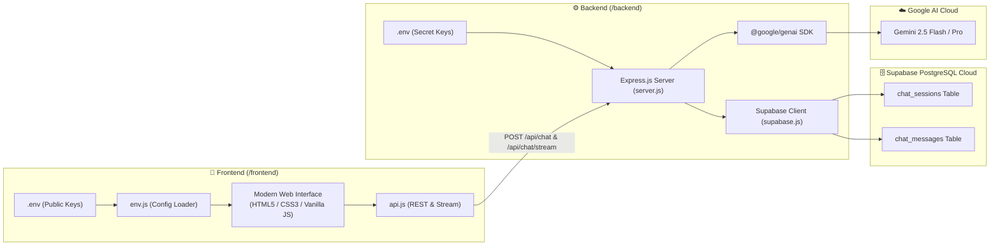

# 🤖 Gemini AI Chatbot (Full-Stack + Supabase Database)

A modern conversational AI chatbot powered by **Google Gemini LLM** with cloud persistence using **Supabase PostgreSQL**, designed with a **strict and clear differentiation** between the **Frontend** and **Backend** folders.

---

## 🏗️ Architecture & Database Flow



---

## 📁 Directory Structure & Environment Files

```
WORK SHOP/
│
├── ⚙️ backend/                        # BACKEND SERVICE (Node.js & Express)
│   ├── .env.example                   # Backend environment template
│   ├── .env                           # Backend secrets (Gemini Key & Supabase Keys)
│   ├── package.json                   # Node dependencies (@google/genai, @supabase/supabase-js)
│   ├── server.js                      # Express API server with chat & session routes
│   ├── supabase.js                    # Supabase database client & CRUD methods
│   ├── supabase_schema.sql            # SQL migration script for tables & RLS
│   └── README.md                      # Backend documentation & endpoints
│
├── 🎨 frontend/                       # FRONTEND CLIENT (Static Web UI)
│   ├── .env.example                   # Frontend environment template
│   ├── .env                           # Frontend environment variables (Public URL & Anon Key)
│   ├── index.html                     # Semantic layout, chat container, settings modal
│   ├── css/
│   │   └── style.css                  # Custom cosmic dark theme, glassmorphism
│   ├── js/
│   │   ├── env.js                     # Environment loader (reads frontend/.env & /api/config)
│   │   ├── api.js                     # API client for Gemini and Supabase endpoints
│   │   └── app.js                     # Chat controller, markdown parsing, sounds, sessions
│   ├── assets/
│   │   └── avatar.jpg                 # AI Assistant crystal emblem
│   └── README.md                      # Frontend documentation & specifications
│
├── .gitignore                         # Excludes node_modules and .env files
└── README.md                          # Master project documentation (this file)
```

---

## 🔑 Environment Variables Breakdown

### 1. `backend/.env` (Server Secrets)
```env
# Google Gemini LLM API Key (Secret)
GEMINI_API_KEY=AIzaSy...your_gemini_api_key_here

# Server Port & Default Model
PORT=5000
DEFAULT_MODEL=gemini-2.5-flash

# Supabase Database Configuration
SUPABASE_URL=https://your-project-id.supabase.co
SUPABASE_ANON_KEY=eyJhbGciOi...your_anon_key_here
SUPABASE_SERVICE_ROLE_KEY=eyJhbGciOi...your_service_role_key_here
```

### 2. `frontend/.env` (Client Public Configuration)
```env
# Supabase Public Project Configuration (Safe for browser use)
SUPABASE_URL=https://your-project-id.supabase.co
SUPABASE_ANON_KEY=eyJhbGciOi...your_anon_key_here

# Backend Service URL
BACKEND_URL=http://localhost:5000

# Application Preferences
DEFAULT_MODEL=gemini-2.5-flash
APP_TITLE=Gemini AI Chatbot
```

---

## 🗄️ Setting Up Supabase Database

1. Sign up or log into **[Supabase](https://supabase.com/)** and create a new project.
2. Go to the **SQL Editor** tab in your Supabase dashboard.
3. Open [`backend/supabase_schema.sql`](file:///c:/Users/marth/OneDrive/Desktop/WORK%20SHOP/backend/supabase_schema.sql), copy its content, and click **Run**.
4. Navigate to **Project Settings &rarr; API** to copy your **Project URL**, **anon key**, and **service_role key**.
5. Paste them into `backend/.env` and `frontend/.env`.

---

## ⚡ How to Run

### Method 1: Full-Stack Dev Workflow (Two Terminals)
**Terminal 1 (Backend API):**
```bash
cd backend
npm run dev
```
Runs the Express API on **`http://localhost:5000`** with auto-reload.

**Terminal 2 (Frontend Dev Server):**
```bash
cd frontend
npm run dev
```
Runs the Vite dev server on **`http://localhost:3000`** with live reloading and proxy to backend.

---

### Method 2: One-Command Combined (Root Directory)
From the root workspace directory:
```bash
npm run dev:backend     # Starts backend
npm run dev:frontend    # Starts frontend
```

---

### Method 3: Backend-Only Mode (Serves Frontend Automatically)
```bash
cd backend
npm start
```
Open **`http://localhost:5000`** directly in your browser.

*(Note: The chatbot also includes an automatic local storage fallback. If Supabase keys are not set yet, you can still test the Gemini chatbot immediately, and cloud database sync activates as soon as your credentials are provided!)*
